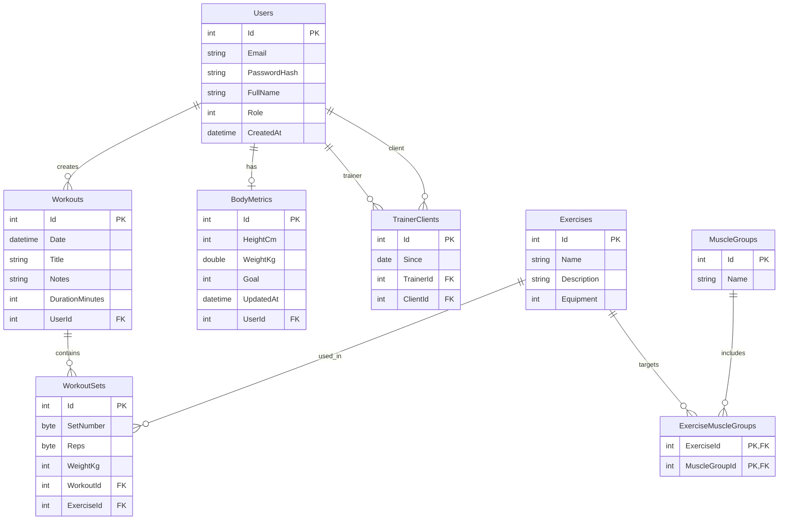

# FitTrack

**FitTrack** არის C# და ASP.NET Core Web API-ზე შექმნილი ფიტნესის ტრეკერის სისტემა. 
მისი მიზანია მომხმარებლებს დაეხმაროს სავარჯიშოების, ვარჯიშების ისტორიისა და ფიზიკური მონაცემების მართვაში, 
ასევე საკუთარი პროგრესის მონიტორინგში.

## გამოყენებული ტექნოლოგიები

- C# / .NET 10
- ASP.NET Core Web API
- Microsoft SQL Server
- Entity Framework Core
- JWT Authentication
- BCrypt Password Hashing
- AutoMapper
- FluentValidation
- Swagger / OpenAPI

## ძირითადი ფუნქციონალი

- მომხმარებლის რეგისტრაცია და ავტორიზაცია.
- როლებზე დაფუძნებული ავტორიზაცია (Trainer და Member).
- სავარჯიშოების დამატება, ნახვა, განახლება და წაშლა.
- კუნთების ჯგუფებისა და სავარჯიშოების მართვა.
- ვარჯიშების ისტორიის შენახვა.
- სხეულის მონაცემების (სიმაღლე, წონა და მიზანი) მართვა.
- ყოველკვირეული სტატისტიკის მიღება.
- კონკრეტული სავარჯიშოს პროგრესის ნახვა.

## პროექტის სტრუქტურა

```text
FitTrack/
├── Controllers/
├── DTOs/
├── Data/
│   └── Seed/
├── Entities/
├── Enums/
├── Exceptions/
├── Extensions/
├── Filters/
├── Helpers/
├── Mapping/
├── Migrations/
├── Properties/
├── Services/
├── Validators/
├── Program.cs
├── FitTrack.csproj
└── FitTrack.slnx
```

## ინსტალაცია და გაშვება

### საჭირო პროგრამები

- .NET 10 SDK
- Microsoft SQL Server (ან SQL Server LocalDB)
- Visual Studio ან Visual Studio Code

### 1. Repository-ის კლონირება

```bash
git clone https://github.com/GiorgiBeruashvili4/FitTrack.git
cd FitTrack
```

### 2. Connection String-ის კონფიგურაცია

გახსენით `appsettings.json` და შეცვალეთ `ConnectionStrings` სექცია თქვენი SQL Server-ის პარამეტრების შესაბამისად.

მაგალითი LocalDB-სთვის:

```json
"ConnectionStrings": {
  "Connection": "Data Source=(localdb)\\MSSQLLocalDB;Initial Catalog=FitTrack;Integrated Security=True;Trust Server Certificate=True"
}
```

შეგიძლიათ გამოიყენოთ საკუთარი SQL Server-ის Connection String-იც.

### 3. JWT კონფიგურაცია

Development გარემოში JWT-ის გასაღების კონფიგურაცია შეგიძლიათ User Secrets-ის საშუალებით:

```bash
dotnet user-secrets set "Jwt:Key" "YOUR-SECRET-KEY-AT-LEAST-32-CHARACTERS"
```

### 4. NuGet პაკეტების აღდგენა

```bash
dotnet restore
```

### 5. Entity Framework Core-ის ინსტრუმენტები

თუ `dotnet ef` ჯერ არ გაქვთ დაყენებული:

```bash
dotnet tool install --global dotnet-ef
```

### 6. მონაცემთა ბაზის შექმნა და მიგრაციები

```bash
dotnet ef database update
```

ეს ბრძანება არსებულ მიგრაციებს გამოიყენებს და მონაცემთა ბაზის შესაბამის სტრუქტურას შექმნის.

### 7. აპლიკაციის გაშვება

```bash
dotnet run
```

აპლიკაციის გაშვებისას ავტომატურად სრულდება მონაცემთა ბაზის მიგრაციებისა და საწყისი მონაცემების შემოწმება.

Swagger UI ხელმისაწვდომია Development გარემოში აპლიკაციის გაშვების შემდეგ.

## Seed მომხმარებლები

პროექტში გათვალისწინებულია სატესტო მომხმარებლები, რომლებიც მონაცემთა ბაზის პირველად შევსებისას ავტომატურად იქმნება.

| როლი | Email | Password |
|---|---|---|
| Trainer | trainer@gmail.com | Trainer123! |
| Member | member@gmail.com | Member123! |
| Member | stranger@gmail.com | Stranger123! |

პაროლები ინახება BCrypt-ის გამოყენებით ჰეშირებულ ფორმატში.

**შენიშვნა:** ეს მონაცემები განკუთვნილია მხოლოდ ლოკალური ტესტირებისთვის და არ უნდა გამოიყენოთ Production გარემოში.

## მონაცემთა ბაზის ER დიაგრამა

ქვემოთ მოცემულია FitTrack-ის მონაცემთა ბაზის ძირითადი Entity-ებისა და მათ შორის არსებული კავშირების დიაგრამა.


